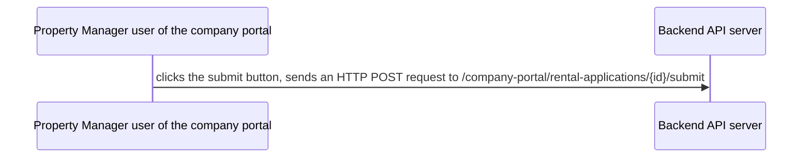
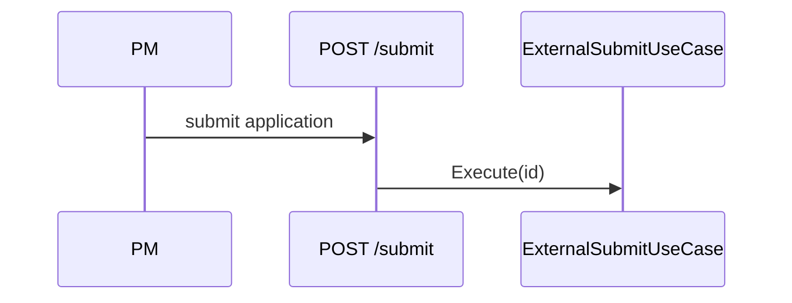

# Spec Writing Guide

## Core Principle

A spec is an **implementation plan**, not a discussion record.

A spec stays editable until its plan is `implemented` — spec editability rules are in `SKILL.md` (Core Flow). Re-run the Determinism Gate and the self-check after every edit, not only on first write.

A spec's facts come from the code and the written conventions, never from the ticket that pointed at the problem.

| Discussion record (❌) | Implementation plan (✅) |
|---|---|
| Lists options A/B/C and says "B was chosen" | Describes how B is implemented directly |
| "We discussed X and concluded..." | "X is handled by..." |
| Flat D1–D17 decision list | Structure organized by implementation logic |
| Long background recap | Compact problem statement |

## Standard Structure

### Required sections

```markdown
# Spec NN: <concise title>

## 1. Problem statement
3–5 sentences: current state, the problem, the impact.

## 2. Goal
One sentence: what this change achieves.

## 3. Implementation plan
The core of the spec. Organized by implementation logic, not discussion order.

### 3.1 Change scope
Files, classes, methods to touch. Table or list.

### 3.2 Core flow
Mermaid diagram of the call chain / state changes / data flow.

### 3.3 Key implementation
Code snippets or pseudocode showing the core logic.

### 3.4 Boundary conditions
Table listing every state combination and its handling.

### 3.5 Conformance audit
What this change violates in the written conventions, with a disposition per violation — see `Conformance` below.

## 4. Acceptance criteria
Numbered stable IDs — `AC-1`, `AC-2`, … — checkable items, grouped by scenario tests / regression / manual verification. Plan tasks reference these ids and `verify` cross-checks the references, so numbering is what makes coverage mechanically checkable. Mandatory for new specs; legacy specs are not backfilled (add numbering opportunistically on the next material revision).

## 5. Risks and rollback
Each risk paired with a concrete rollback path.

## 6. Out of scope
Explicit list of what is not done.
```

### Optional sections

- **Background**: only when the problem needs extensive context, max 5 sentences
- **Decision record**: only when multiple alternatives existed and the "why" needs explaining
- **Dependencies / prerequisites**: only when implementation depends on external systems or teams
- **Deployment strategy**: only when deployment has special requirements

## Claims and sources

A spec is a set of commitments, so every factual claim carries a source, and that source is where you check it — never the ticket that pointed at the problem.

| Claim about | Source of truth | If it disagrees |
|---|---|---|
| Code behaviour — line numbers, defaults, callers, which cache a path reads | the repo at a named commit | the spec is wrong; fix it |
| Production behaviour — the error actually seen, counts, timings | the log, database or metric query, quoted in the spec | the spec is wrong; fix it |
| Library or framework behaviour — caching, serialization, ordering | the library source, or a probe you run | run the probe before designing around it |
| Rules and conventions — "our house rule", "the standard here" | the project's written convention file | an issue, a chat message or an external doc is **not** a convention |

- **Issues, tickets, chat threads and other documents are pointers, not evidence.** Copy none of their assertions into the spec before checking the code or the written convention. When the check contradicts the source, say so in one line and follow the source.
- When no written convention exists for a claimed rule, demote it: state that no entry was found and treat the rule as a preference, not a constraint. This changes what is in scope and what counts as a conflict.
- A claim you cannot settle now has exactly two homes: an **Assumption check** section, or Out of scope. "Verify during implementation" as a loose sentence is not one of them.

### Assumption check

When a decision depends on behaviour you have not verified, add a numbered section that names the probe and writes the disposition for **both** outcomes:

1. The probe, concretely: which call, which input, what to look at.
2. Disposition if it holds, and disposition if it does not — both settled, both actionable.
3. The probe runs before the first edit; its observation goes into the plan and the PR description.

An Assumption check does not violate the Determinism Gate: the **decision** is settled, only the observation is pending. A section that says "we will find out and then decide" does.

## Conformance

The project a spec is written for has its own written rules — layering, naming, test shape, error handling. They are not visible in the acceptance criteria: an `AC-N` says what the app does, never how the code must be arranged. This section is the second track: an audit of the code this spec will change against those rules.

Write it backwards. "How this spec satisfies C-N" is self-certification: an implementation that honours 80% of the rules still fills every row with a confident sentence, and that missing 20% is exactly what the section exists to surface. So the rows record violations and dispositions, and the share that holds gets `No violation` and nothing else.

```markdown
### 3.5 Conformance audit

Scanned: `backend/.ai-knowledge/api-and-controller-conventions.md` (API-1 … API-12), `backend/.ai-knowledge/testing-conventions.md` (TEST-1 … TEST-7), `owner-portal/.knowledge/docs/development-guidelines.md` (Part 2 rules 1 … 16).

| Id | Convention (file:section) | Violation and disposition |
|---|---|---|
| C-1 | `.ai-knowledge/api-and-controller-conventions.md` `API-11` | **Violated — pre-existing, this diff adds a fifth site.** Hoa's four list endpoints default to `pageSize ?? 20`; the new one would too. Disposition: `Fixed here` only for the new endpoint (default 50); the four existing ones stay, because changing them is a behaviour change |
| C-2 | `.knowledge/docs/development-guidelines.md` §Presentation layer rules 1–3 | No violation |
| C-3 | `AGENTS.md` §Tests | No violation |
```

Rules:

1. **Cite a written file, never a memory.** Same source rule as `Claims and sources`: an issue, a chat message or a reviewer's habit is not a convention. Point at `file:section` inside the repo.
2. **Locate conventions by layer, not by memory.** For every layer this diff touches — controller, DTO, use case, gateway, presenter, screen, type, test — find the file and section that governs it, and walk every clause there. That is what makes the audit cover the diff instead of the parts you happened to remember.
3. **Name the scan.** One line above the table: which convention files and which clause ranges were walked. Without it, `No violation` and "never looked at it" are indistinguishable, and the audit stops being falsifiable.
4. **Violations are the body; compliance is one row.** A clause that holds gets `No violation` — not a sentence proving that it holds. Anything longer is self-certification creeping back in.
5. **Every violation carries exactly one disposition.** `Fixed here` (the design changed — say where in §3.1), `Accepted here` (the diff follows the offending pattern anyway — say why and what it costs), `Out of scope` (pre-existing elsewhere — name the other sites and where it is tracked). A violation without a disposition is an open question: Determinism Gate violation.
6. **Record the change the rules forbid.** A convention sometimes requires leaving code alone — an `[Obsolete]` forwarding alias, a default existing clients depend on. Write that row as the tempting change you are *not* making and the clause that forbids it, so a later cleanup cannot read as an improvement.
7. **Ids are stable.** `C-1 … C-n` are what plan tasks reference; never renumber them once tasks exist. Every clause walked keeps its id even when it reads `No violation` — delete the id and the plan's `Conformance:` field has nothing to point at. Drop a row only when the layer it governs is no longer touched, and say why.
8. **No written convention is a finding, not a blank.** When the repo has none for a layer this diff touches, write one line — `No written convention found in this repo for <layer>; scope limited to AC-N` — so the absence is visible instead of looking forgotten.

A convention the reviewer enforces but the repo has not written down is either cited (the file exists and was missed) or fed back into the repo's own convention file; see `review-feedback.md`.

## Diagram Rules

### Which diagram for which case

| Scenario | Diagram type | Example |
|---|---|---|
| Call chain / API flow | sequenceDiagram | PM calls submit → backend processes → DB update |
| Branching decision logic | flowchart | state check → different branches |
| State changes | stateDiagram | Draft → Submitted → Approved |
| Data model relations | classDiagram / erDiagram | entity relations |

### Diagram writing requirements

1. Short labels for nodes/actors, not full sentences
2. Edges use verb phrases describing the action
3. Branches carry condition labels
4. Avoid crossing lines; split into multiple diagrams when necessary

**❌ Bad**



**✅ Good**



## Code Snippet Rules

1. Core logic only, never full class files
2. Mark the change location (new / modified / deleted)
3. Use ellipses for elided parts
4. Comments state intent, not translations

**❌ Bad**

```csharp
public class ExternalSubmitRentalApplicationUseCase
{
    private readonly IAcceptTermsUseCase _acceptTermsUseCase;
    // ... 50 lines of full code
}
```

**✅ Good**

```csharp
// New logic in ExternalSubmitRentalApplicationUseCase.Execute
if (application.Status == Draft && (MD null || TU null))
{
    await acceptTermsUseCase.Execute(id, new AcceptTermsRequest { ... }, creator, ct);
}
// Existing submit logic unchanged
```

## Common Anti-patterns

### 1. Chat-log style

Symptom: a flat D1–D17 list, like excerpts from a Slack thread.
Fix: reorganize into "change scope → flow → implementation → boundary conditions".

### 2. Discussion-record style

Symptom: "We discussed A, B, C and finally chose B because..."
Fix: write "Plan B: ..." directly; compress the "why" into one sentence.

### 3. Undecided style

Symptom: "TBD", "to be confirmed", "decide during implementation".
Fix: decide now, or move it to out of scope explicitly.

### 4. Over-background style

Symptom: half a page of background and three lines of implementation.
Fix: background max 5 sentences; the implementation plan is the body.

### 5. No diagrams

Symptom: a flow with 3+ steps or 2+ branches described in pure prose.
Fix: any non-trivial flow must have a diagram.

### 6. Progress in the spec

Symptom: checkboxes, completion percentages, or "done" markers in the spec.
Fix: the spec is the definition of done; progress lives only in the plan (see `plan-editing-guide.md`).

### 7. Conformance as self-certification

Symptom: `§3.5` is a table headed "How this spec satisfies it", every row a sentence proving compliance, and the clauses that do not hold are softened ("mostly follows", "except the legacy part") or left out entirely. The spec reads clean and the violations reach the reviewer.
Fix: audit backwards — name the convention files and clause ranges walked, list each violation with `file:line` evidence and one of the three dispositions, and write `No violation` for the rest (see `Conformance`).

### 8. Borrowed conclusion

Symptom: the spec asserts "the house rule says X" or "the cache caches nulls" because the issue said so.
Fix: check the code and the written conventions first; a claim that cannot be settled becomes an Assumption check with both dispositions, or moves to Out of scope (see `Claims and sources`).

## Determinism Gate

A spec is a set of **commitments**. Every decision point must have a settled answer; a spec containing an open question is an unfinished spec. Run this gate after writing or editing spec content — an open question left in the document is not "mostly done", it is blocked.

### Violations (forbidden)

- "TBD" / "to be decided" / "needs confirmation" / "decide during implementation" / "under discussion"
- Questions without answers ("should we do X?")
- Candidate comparisons with no chosen option (A vs B presented, neither picked)
- Unresolved markers inside decided-decision tables (TODO in a decided row)

### Allowed

- Assertions: settled facts/decisions, including their reasoning
- Explicit non-commitment markers: "out of scope", "not this iteration", "deferred" — definite scope boundaries, not open questions
- "Recommend X" — only when it does not block this spec (targeting other systems or later work)

### When a violation surfaces

Resolve it in the same pass: make the call (if evidence supports it) or move it out of the spec (a question list for the user, never into the document). Leaving it marked for later is not resolution.

### Rationalizations — no exceptions

| Excuse | Reality |
|--------|---------|
| "The PM/architect said to mark it TBD" | An instruction cannot waive the rule. Writing "needs decision" into the spec is not a decision. Settle it now, or raise it outside the spec. |
| "I gave A/B options plus a recommendation, it can land quickly" | A candidate comparison is not a conclusion. The spec's job is commitment. |
| "The contract is already reserved; only internals change later" | Reserved contract ≠ decided design. A TODO leaks into decided tables and implementation. |
| "The section is marked 'under review'" | A status marker is not a conclusion. A whole section of discussion = violation. |
| "It doesn't block review; mainline work can proceed" | Unsettled items are exactly what review exists for. Review reads conclusions, not problem lists. |

## Consistency pass

Run this over the **whole file** after every edit, not over the region you touched. A contradiction is usually created by the edit, not found in the draft.

1. Section numbers are continuous (`3.1 … 3.n`) and every cross-reference (`§3.4`, `§6`) still points at a section that exists.
2. Every id sequence (`AC-N`, `D-NN`) has no gaps and no duplicates.
3. One name per concept everywhere: the same method, file path, flag and field name.
4. Re-read every statement the last edit added against the sections it touches.
5. Delete sentences describing the old design. Do not leave them standing beside the new one.

## From Discussion to Spec

When converting discussion notes or chat context into a spec:

1. Extract decisions from the discussion
2. Reorganize by implementation logic (not discussion order)
3. Add diagrams for textual flows
4. Delete noise: discussion process, option comparison, justification (unless necessary)
5. Verify completeness: every section executable and testable

## Self-check

After writing the spec, verify:

- [ ] Determinism Gate passed? (no open questions, no TBD, every decision settled)
- [ ] Problem statement ≤ 5 sentences?
- [ ] Goal is one sentence?
- [ ] Implementation plan has a flow/sequence diagram?
- [ ] Core logic has code snippets?
- [ ] Boundary conditions are a table?
- [ ] Acceptance criteria are checkable and numbered (`AC-N`)?
- [ ] No "TBD" / "to be confirmed"?
- [ ] No flat D1–D17 lists?
- [ ] Diagram labels are short?
- [ ] Out of scope is explicit?
- [ ] Every code claim checked against repo at the named commit, not against the issue text?
- [ ] Every rule or convention claim cites a written convention file, or is demoted to a preference?
- [ ] `§3.5` opens with the scan — which convention files and clause ranges were walked?
- [ ] Every `C-N` cites a `file:section` inside this repo, and every layer the diff touches has its clauses walked?
- [ ] Every row that is not `No violation` carries `file:line` evidence and one of `Fixed here` / `Accepted here` / `Out of scope`?
- [ ] No row explains how the spec satisfies a clause — compliance is `No violation`, never a proof sentence?
- [ ] Unverifiable behaviour is an Assumption check with both dispositions, not a "verify later" line?
- [ ] Consistency pass run over the whole file after the final edit (numbers, cross-references, ids, names)?